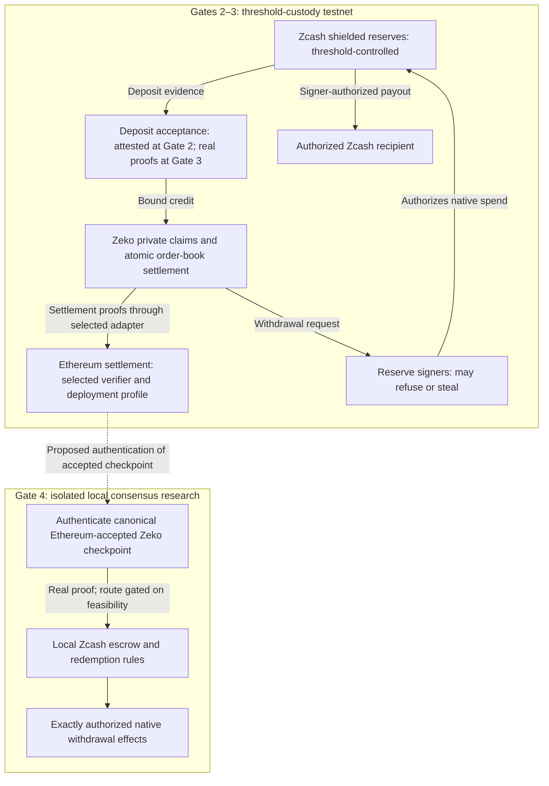

# IronLimb: Technical Design and Threat Model

Supporting document 1 · November 5, 2026 · Proposed design, not implemented results

## Deliverable

Build a shielded-ZEC testnet bridge and confidential ZEC/ETH order-book exchange, then a local research prototype of Zcash-enforced redemption. The exchange adapts Zeko's existing private order book, demonstrated on Sepolia; proof-bound ZEC issuance and its integration remain new IronLimb work. The testnet application uses threshold custody. The consensus prototype investigates a different release mechanism; it does not retroactively remove trust from earlier deposits.

IronLimb is an application and interoperability project built around Zcash’s existing Ironwood pool. Its confidential note pool on Zeko is application state, not a new Zcash shielded pool.

## Architectural roles

IronLimb brings private application logic to the Zcash ecosystem by executing it on Zeko and settling proofs through Ethereum. Zcash supplies shielded ZEC and compatible cryptographic foundations; Zeko supplies execution and recursion; Ethereum supplies the selected verifier/settlement environment and financial-asset connectivity. Privacy of Zeko application state is implemented by IronLimb's note and exchange constraints, not inherited automatically from either chain.

Ethereum is the settlement choice for this design, rather than a claim that every private application requires Ethereum. Connections to existing Ethereum DeFi contracts need their own adapters, messages, supported assets, and liquidity. The funded baseline is the confidential ZEC/ETH exchange.

## Architecture schematic

Proposed architecture, not an implemented deployment. The selected verifier, settlement profile, DA/admin assumptions, and proof adapters must be named in the deployment manifest. The two custody mechanisms below are separate; the research branch is not a live exit from testnet reserves.



Gate 2 does not satisfy proof-bound issuance. Gate 3 does not remove the reserve signers. Gate 4 neither activates public consensus rules nor migrates testnet reserves automatically.

## Components and authority

| Component | Responsibility | Authority that must remain visible |
| --- | --- | --- |
| Zcash reserve | Hold Ironwood notes | Native spending threshold before consensus enforcement |
| State authenticator | Establish accepted Zcash roots/history | Chain-selection, confirmation, upgrade, and receipt-verification assumptions |
| Deposit verifier | Qualify a deposit and its credit recipient | Exact program/VK, domain, uniqueness construction, and upgrade rules |
| Ethereum settlement | Accept proof-bound Zeko checkpoints | Actual verifier, finality, upgrade controls, and DA/exit dependencies |
| Zeko claim pool | Track confidential liabilities and settle trades | Note constraints, accepted-state root, nullifiers, and admin permissions |
| ETH adapter | Back confidential ETH claims | Actual Ethereum/Zeko asset mapping, bridge, and verifier profile |
| Redemption mechanism | Debit liabilities and release native value | Signers on testnet; consensus-defined effects in the research prototype |
| Data/recovery services | Deliver notes and reconstruct witnesses | Availability, backup, signer, and sequencing dependencies |

The deposit attestation authorization and reserve spending authorization are separate. A verifier change cannot revoke the reserve key. A future consensus design that retains a discretionary spending bypass must disclose it and cannot claim permissionless redemption.

## Deposit statement

The final relation is selected at Gate 1. Its required properties are:

1. A qualifying output commitment belongs to authenticated canonical history under the accepted root and confirmation policy.
2. Its opening binds the supported asset, amount, and designated custody recipient.
3. Issuance is bound to the user's authorized credit recipient and bridge instance.
4. A deposit is credited at most once, including across upgrades and claim retries.
5. Network, shielded pool, protocol version, and verification key cannot be substituted.
6. Encrypted delivery or memo requirements are actually constrained where relied upon.

The originating commitment remains private where the leakage target requires it. A plain public hash of a known commitment is enumerable; an arbitrary user-chosen secret is not automatically duplicate-resistant. Gate 1 compares uniqueness constructions, who holds their secrets, rotation behavior, and linkage to later reserve spends. No particular construction is represented as solved today.

An included output is not proof of perpetual reserve backing: the custodian can subsequently spend it. Reserve availability and issued liabilities therefore have their own accounting and custody assumptions.

## Existing cryptography and new implementation

IronLimb reuses established Zcash and Zeko proof-system machinery. It does not propose new curves, a new proving system, a new Zcash shielded pool, or a redesign of the deployed Ironwood Action circuit.

The integration still needs application-specific proof relations and their implementation. Candidate A requires expressing the existing Halo2 verification algorithm as constraints in Kimchi; this is a new verifier circuit even though the algorithm being checked already exists. Candidate B requires constraints for the selected note-opening/inclusion and credit-binding relation. Confidential transfers and order-book settlement reuse existing Zeko application machinery while integrating constraints for authorization, uniqueness, conservation, and exchange terms with IronLimb's claim accounting. Gate 4 adds a local consensus-verification/custody prototype.

The implementation lead therefore owns provable-program engineering, constraint completeness, tests, and reference compatibility. The title does not imply invention of new cryptography. Independent protocol/security review remains necessary for the newly implemented relations.

## Verification candidates

**A: full Ironwood bundle verification in Kimchi.** Implement the actual Halo2 verifier relation and bind its statement to the qualifying output. Canonical-state authentication and deposit-specific recipient/value binding remain necessary.

**B: note opening and inclusion under authenticated state.** Verify the qualifying note relation and membership, relying on the explicitly defined chain-validation/light-client model rather than duplicating every bundle check. This changes the proof work and assumption allocation; it is not a claim that authentication is free.

Benchmark both against a common statement. Report implementation coverage, measured versus estimated costs, constraints, memory, proving latency, verification cost, proof size, and amortization. Set continuation ceilings before the final comparison. Shared Pasta foundations motivate the experiment; they do not predetermine the result.

If a zkVM authenticates roots, the acceptance path must enforce the real receipt and exact public outputs. Running a guest, posting a signed root, or accepting empty proof bytes does not meet proof-verified acceptance.

## Redemption and accounting

The reverse statement binds accepted Zeko state, the consumed withdrawal claim, recipient, amount, fees, and exact authorized Zcash effects. For the selected Ethereum-settled deployment, authenticate the canonical Ethereum-accepted Zeko checkpoint under an explicit finality model. Gate 1 must price this path, including any required Ethereum-state or consensus verification; verifying an arbitrary valid Zeko history is not a substitute. Conservation must cover confidential balances, reserve movements, pending withdrawals, refunds, and protocol fees without counting a claim twice.

Canonical-checkpoint authentication is a feasibility dependency in its own right. Gate 1 must identify whether the construction needs Ethereum light-client/finality verification, a proof adapter, or another explicitly justified mechanism, and cost the complete path against agreed resource and budget ceilings. It must not treat checkpoint provenance as an already implemented feature. If no sound route fits, publish the blocker and stop downstream work unless an amended scope is approved. Gate 4 requires real enforcement of the selected route; a trusted signer or a mocked Ethereum acceptance boundary cannot satisfy it.

### Required redemption assertions

These are requirements for Gate 4's proposed consensus path, not guarantees of the threshold-custody testnet:

1. The checkpoint is canonical Ethereum-accepted Zeko state under specified finality, deployment, and upgrade rules.
2. The withdrawal follows that state and is authorized by the claim holder.
3. The claim cannot be redeemed twice, traded while pending, or both refunded and paid, including across checkpoint changes.
4. Authorization binds the exact Zcash transaction effects, including recipient, amount, and fees.
5. Native release preserves reserve/liability accounting and the specified remaining escrow state.
6. Zcash enforces the selected release/recovery rules and domain bindings without an undisclosed signer bypass.

Required tests include duplicate deposits, duplicate exits, wrong asset/domain/recipient, altered fee or output, stale or reorganized anchors, conflicting state transitions, and unauthorized upgrade paths.

For migration, reconcile reserves against all outstanding liabilities, classify shortfalls, construct a validated opening state, and physically move reserves to the new custody mechanism. Preserve user balances only through an evidenced mapping. Previously attested liabilities do not become certified by switching a verifier address.

## Proposed relation sketches

**Not implemented, benchmarked, or a complete specification.** Uppercase operations below name obligations whose exact relations, inputs, cost, and enforcement boundaries Gate 1 must specify. They are not existing APIs. In particular, `AUTHENTICATE_*`, `SELECTED_DEPOSIT_RELATION`, and `CHECK_UNIQUENESS` do not stand in for solved components.

The sketches describe constrained statements and atomic acceptance, not submission of private witnesses to an operator. Amounts, recipients, and note data may be represented by commitments rather than plaintext public inputs, according to the declared privacy target. Gate 1 must specify exactly what is public, private, and authenticated.

```text
DEPOSIT_RELATION(statement, private_witness, policy):
    require domains_and_keys_match(policy, statement)
    history = AUTHENTICATE_CANONICAL_ZCASH_HISTORY(statement, policy)
    require SELECTED_DEPOSIT_RELATION(
        route = policy.A_or_B, history, private_witness, statement)
    require note_value_and_custody_recipient_are_bound(...)
    require private_credit_recipient_is_authorized(...)
    require CHECK_UNIQUENESS(old_state, new_state, deposit, policy)
    require required_memo_and_encrypted_delivery_bindings_hold(...)
    require per_asset_issuance_accounting_is_preserved(...)

ACCEPT_DEPOSIT(proof_or_composition, statement, current_state, policy):
    require well_formed_bounded_inputs_and_current_policy(...)
    require statement.old_state_matches(current_state)
    require VERIFY_REAL_COMPLETE_DEPOSIT_RELATION(...)
    atomically apply the proved uniqueness and private-credit transition
```

A must bind the actually verified Ironwood bundle to the qualifying output; B must enforce its note-opening/inclusion relation under the selected authenticated-state model. Neither can replace canonical authentication with an operator assertion. Any separate chain-authentication receipt must be verified and bound to the same anchor and policy by the complete acceptance path.

```text
CONSENSUS_REDEMPTION_RELATION(tx, proof_or_composition, escrow, policy):
    require well_formed_bounded_inputs_and_current_policy(...)
    checkpoint = AUTHENTICATE_CANONICAL_ETHEREUM_ACCEPTED_ZEKO_STATE(...)
    require REAL_PROOF_OF_AUTHORIZED_CLAIM_FROM(checkpoint, ...)
    require CHECK_REDEMPTION_UNIQUENESS_AND_CONFLICTS(escrow, ...)
    require tx.effects_match_exactly_authorized_effects(...)
    require reserve_liability_and_remaining_escrow_rules_hold(...)
    require specified_recovery_and_domain_rules_hold(...)
    atomically consume the claim and apply the native escrow transition
```

The second sketch requires proposed local Zcash rules, not just a Zeko application proof. A checkpoint signature, a valid proof of an arbitrary Zeko fork, or an unverified Ethereum receipt cannot satisfy its authentication obligation. The threshold testnet instead relies on reserve signers for native payout and authenticates the resulting payout before finalizing its claim accounting.

### Uniqueness candidates to evaluate

No construction is selected. These candidates must be compared against the same duplicate-credit requirement, including retries, custody transfers, and upgrades.

| Candidate | Required capability/binding | Questions Gate 1 must resolve |
| --- | --- | --- |
| Zcash note's native nullifier | Derive the correct note nullifier with the required authority and prove its binding to the qualifying note | Who has the needed key material? Can client proving avoid revealing custody secrets? Does publication link issuance to a later reserve spend? |
| Bridge-specific deterministic keyed tag | Prove the qualifying commitment maps to exactly one tag under the bridge's fixed committed secret and domain | Who computes it? Can the operator censor computation? How are the key and domain fixed, and how is duplicate resistance preserved across rotation and versions? |

A plain public hash of an observable commitment is enumerable. An arbitrary depositor-chosen secret can allow multiple tags for one deposit. A changing bridge secret can also change the tag for an already credited deposit. Neither candidate is acceptable without an explicit proof relation, secret-access model, and upgrade/replay analysis. No performance or unlinkability result is claimed.

### Accounting lifecycle

Names below describe logical states; Gate 1 specifies their commitments, authenticated transitions, and recovery evidence. For each asset, spendable claims, encumbered claims, finalized payouts, fees, and refunds are tracked separately. A reserved claim is not spendable a second time.

| Transition | Required evidence/invariant | Native custody consequence |
| --- | --- | --- |
| Uncredited deposit → active claim | Qualifying deposit, authorized credit, uniqueness, per-asset issuance accounting; real proof enforcement from Gate 3 | Native ZEC remains under the reserve threshold |
| Active claims → exchanged active claims | Both parties' authorization, current spend and order state, per-asset conservation, limits/expiry, cancellation status, and remaining quantity; each fill's two legs atomic | No native ZEC moves; ownership of liabilities changes |
| Active claim → withdrawal pending | Authorized request encumbers the amount; it cannot trade or create another withdrawal | A request does not compel threshold signers to pay |
| Withdrawal pending → redeemed | Authenticated payout bound to this request on testnet; the selected real-proof consensus release in Gate 4 | Finalize consumption once; do not count the payout and the claim as simultaneous spendable value |
| Withdrawal pending → active claim/refund | Cancellation evidence must exclude a competing payout, including one already authorized but not yet confirmed | No refund based solely on timeout or an operator's assertion of nonpayment |

Safe refund conditions are a Gate 1 specification and Gate 2 acceptance obligation. If an outstanding native payment can still execute, restoring its claim creates a double-payment risk. A UI timeout or a fresh deployment does not resolve that race.

The reserve/liability accounting invariant is a target for legitimate transitions, not evidence that a dishonest threshold cannot spend reserves outside this system. Reserve reconciliation must detect and disclose shortfalls; a deposit proof alone cannot enforce continued backing.

### Acceptance-path validation order

1. Bound input sizes and identify the exact network, bridge, pool, protocol, program/VK, deployment, and upgrade policy.
2. Check the claimed prior accounting/escrow state against the actual acceptance state; specify concurrency and reorganization handling.
3. Verify real canonical-history/checkpoint authentication and bind its outputs to the same deposit or redemption relation. Their execution may be composed, but no unauthenticated output can authorize acceptance.
4. Verify authorization, note/claim binding, uniqueness, conservation, exact effects, and required encrypted-delivery constraints.
5. Apply the verified state transition atomically. A rejected proof cannot leave a credited tag, minted claim, consumed withdrawal, or native release behind.
6. Record acceptance evidence and recovery data under the declared leakage policy. For asynchronous threshold payouts, use the pending/finalized lifecycle above; do not claim cross-chain atomicity.

## Worked accounting example

Illustrative Gate 3 testnet execution with fees omitted, not a quoted exchange rate or proof of anonymity:

| Step | Claims on Zeko | Native ZEC reserve | Who can interfere? |
| --- | --- | --- | --- |
| Alice deposits 10 test ZEC and obtains proof-verified credit | Alice holds 10 zkZEC; the maker separately supplies backed zkETH | 10 ZEC under threshold control | The selected chain/proof and note-delivery paths must work; reserve signers retain native spending power |
| Alice trades 4 zkZEC for an agreed amount of zkETH | Alice retains 6 zkZEC plus received zkETH; maker receives 4 zkZEC and gives up the agreed zkETH | Still 10 ZEC | Both parties must authorize; matcher may see terms; sequencer may censor; ETH backing has separate assumptions |
| Alice requests 6 ZEC redemption | Her 6 zkZEC is pending and cannot trade; maker retains 4 active zkZEC | Still 10 ZEC until payout | Threshold signers may refuse; a request is not an enforced native exit |
| Signers pay Alice; authenticated payout finalizes the claim | Alice's 6 zkZEC is consumed; maker retains 4 zkZEC; Alice's zkETH is unchanged | 4 ZEC backs the maker's claims in this honest execution | A dishonest threshold could steal or double-spend reserves; proof-verified issuance does not prevent it |

Gate 4 investigates a different native release mechanism. It cannot be substituted into this example before its proof path, accounting, migration, and recovery rules are implemented and reviewed.

## Confidential order book

The baseline adapts Zeko's existing private order book for confidential zkZEC/zkETH trading. Reusing the Sepolia-demonstrated implementation reduces implementation risk; proof-bound ZEC issuance, encrypted-note accounting, and the integrated settlement constraints remain proposed IronLimb deliverables.

Each fill consumes authorized inputs and creates the agreed encrypted outputs in one atomic transition. Settlement enforces order authorization, per-asset conservation, current nullifier state, limit prices, expiry, cancellation, and replay protection. Partial fills are supported: a fill may execute less than the full order, but its two asset legs must settle together. Cumulative fills cannot exceed the authorized order quantity. Concurrent fills and cancellation must be checked against accepted order state so a stale match cannot overfill or execute a cancelled order. Failed settlement must not consume inputs, update filled quantity, or leave one asset leg executed.

The integrated design must specify how order identity, authorized terms, cumulative filled quantity, cancellation state, and note nullifiers are bound into acceptance. Order tracking and note-spend uniqueness are distinct obligations; preventing a note double spend alone does not establish the remaining order quantity. Validation includes successful partial fills, sequential and concurrent overfill attempts, cancellation/fill races, expired orders, limit-price violations, and one-sided settlement attempts.

The baseline protects individual pool balances and amounts from direct public disclosure. Matchers/counterparties may learn agreed terms. Wallet recovery includes encrypted note retrieval and restoration, with fee-account linkage measured.

## Adversaries and validation

| Adversary/failure | Required response or disclosed limit |
| --- | --- |
| Malicious claimant | Reject fabricated, duplicate, redirected, or wrong-domain credit |
| Dishonest reserve threshold | Testnet remains vulnerable to theft/refusal; disclose rather than attribute safety to deposit proofs |
| Malicious sequencer | Test censorship and shutdown; claim independent exit only after a successful drill |
| Withholding DA/witness service | Detect the failure and exercise documented reconstruction; commitments alone do not prove retrieval |
| False chain view or reorg | Apply explicit selection/freshness rules and stop acceptance on inconsistent history |
| Matcher/front end | Enforce user-authorized terms and current order state; reject overfills and cancelled orders; disclose what order data it learns |
| Admin or dependency change | Domain-bind configuration, retain evidence, pause affected operations, and revalidate |

Before accepting a state that could make exits depend on new data, specify how that data's availability is enforced. Recovery must use a defined accepted state, prevent double claims, and preserve any application encumbrances. A missing-data drill that merely detects failure is not a successful independent-exit drill.

## Privacy evaluation

Report four observer classes separately: public chain observer, operator/custodian, matcher, and network observer. Evaluate direct fields plus timing, denomination combinations, fee payer, ciphertext retrieval, transaction shape, and reserve-spend linkage.

Client proving keeps witnesses off outsourced provers but does not hide timing. Fixed denominations and batching reduce some correlations but do not establish unlinkability. Transparent escrow values remain visible. The local TZE prototype does not automatically add private application state or hidden bridge values.

## Research versus release

Gate 4 requires an executable local prototype with real proof acceptance. A successful local prototype does not itself change public custody. Consensus activation, upstream merge, comprehensive production audit, and deployment of real user funds are outside this grant. If verification or independent exits remain unresolved, publish the blocker and withhold a production recommendation.

## References

- [Zcash protocol specification](https://zips.z.cash/protocol/protocol.pdf)
- [ZIP 258: Ironwood deployment](https://zips.z.cash/zip-0258)
- [ZIP 222: draft TZE framework](https://zips.z.cash/zip-0222)
- [Existing bridge-extension discussion](https://forum.zcashcommunity.com/t/proposal-trustless-bridging-for-zcash/53884)
- [Zeko settlement implementation](https://github.com/zeko-labs/ethereum-settlement)


- [Ethereum rollup settlement and data availability](https://ethereum.org/developers/docs/scaling/zk-rollups/)
